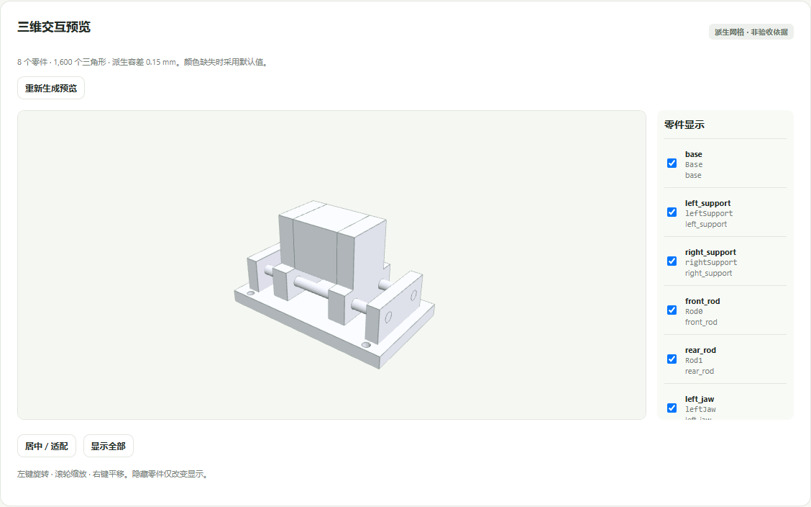

# MechCAD-AgentLab

**面向机械 CAD Agent 的工程验收、缺陷证据与反馈数据系统。**

An artifact-based evaluation and evidence workflow for parametric mechanical CAD. This repository is the public portfolio edition: actual CAD examples, an interactive 3D showcase, generic geometric evaluation code, and reproducible public geometry observations.

**[在线查看三维模型](https://lqqqqqqqqqqqqq.github.io/MechCAD-AgentLab/) · [正式项目展示报告](docs/PORTFOLIO_REPORT.md) · [真实工件](examples/)**



## 项目做了什么

把机械任务转成可执行的验收条件，从保存的 FCStd / STEP / BOM / SVG 重新测量，保留每条规则的观测、判据与异常。完整本地系统还提供参数修改、全交付重导出、独立保存状态核查、冻结重评和历史对比。

```text
公开机械要求 → CAD 提交 → 独立原生测量 → 四态判定与证据
                               ↓
公开开发反馈 → 安全修改新副本 → 全交付导出 → 重新验收
```

- **实际几何**：材料占据、完整孔空域、尺寸、接触与非预期干涉。
- **参数化与交付**：原生驱动、重算、固定接口、STEP/BOM/SVG 与保存状态对应。
- **可信记录**：首次提交、失败、版本、来源、hash、进程故障与受控恢复均保留。
- **直观展示**：浏览器旋转/缩放/平移、逐零件显隐；网格只作显示，不作工程评分依据。

## 三个实际案例

|案例|内容|已记录结果|来源|
|---|---|---|---|
|A|Sketcher / Body / Pad / Pocket 替代建模夹爪|PASS|控制者合法开发样本GF01|
|B|贯通孔旁存在封闭缺料的滑台|FAIL|控制者缺陷样本GF07|
|C|开口39→40mm的公开反馈修复|FAIL → PASS|真实执行的控制者开发演示|

C附带一个**只改变显示状态、几何不变**的可见审阅副本。修复过的早期文件曾把全部最终零件保存为隐藏；原件和首次评分保留，显示修复另建副本并重新验收。参见[显示问题说明](docs/PORTFOLIO_REPORT.md#三维显示问题与修复)。

## 公开仓库可以复现什么

**在线或本地看真实模型：**

```bash
python -m http.server 8080 --directory docs --bind 127.0.0.1
```

打开 `http://127.0.0.1:8080`。静态展示不需要 API key、FreeCAD 或 Node 构建，模型由真实 FCStd 派生；不在浏览器伪造重算或评分。

**用 FreeCAD Python 独立查看材料几何证据：**

```powershell
& '你的FreeCAD目录\bin\python.exe' tools/inspect_native.py `
  --submission examples/B/submission.json --out runs/B_material_observations.json
```

该工具预检原生类型、不执行提交源码，观察保存实体的封闭内壳并核对输入未变。它输出几何观测，**不把任意空腔自动判成工程不合格**；是否允许缺料取决于具体公开合同。

`src/mechcad/`提供实际系统采用的通用评分算法；`tools/`提供可独立执行的公开几何复核。冻结私有任务规则、答案、原始私有运行日志和认证均不在此仓库中。完整本地操作台的真实运行截图与流程见报告；此公开版不宣称能重放未公开的完整Benchmark。

## 已验证与边界

- 原评测准备：114份已有/控制样本 × 2轮 = 228份评分记录，按对应版本程序复核标签核对；这不是228次独立Agent实验。
- 作品阶段：20次开发评分请求，保留10 PASS、5 FAIL、1 UNSUPPORTED及4次启动失败；另有真实原生派生与保存后核查。
- 浏览器：真实Chrome/WebGL验证3个模型的旋转、缩放、平移、零件显隐、居中、刷新与缓存复用；截图来自实际运行，不是渲染示意图。
- 6道实际任务；其余24道仍为蓝图。60件待审工件的专家标签仍为0。正式72次实验未启动。
- 有限姿态采样不证明连续运动、力学、制造或实物可靠性。没有机械专家认证，也没有训练新CAD模型。

## 仓库结构

```text
docs/                     在线三维展示、报告、实际运行截图
examples/A,B,C/           FCStd、STEP、BOM、SVG、提交清单
evidence/                 公开几何观测、反馈修复摘要、环境与浏览器证据
src/mechcad/              通用几何/工程/图纸检查与证据组织
tools/                    原生输入预检、独立材料观测
```

## 我的工作与第三方组件

项目工作包括机械任务合同、确定性评分与证据、表示兼容、缺陷样本、执行隔离/恢复、数据来源、网页与参数交付流程。FreeCAD/OCCT提供几何内核，Three.js提供浏览器显示；它们不是本项目自研。历史作者试跑使用隔离Codex CLI，不能称为训练出的自研CAD模型。

第三方许可见[THIRD_PARTY_NOTICES](THIRD_PARTY_NOTICES.md)。原生CAD例子是项目开发工件，不含客户设计。公开展示仍不应作为未来隐藏测试的作者输入。
