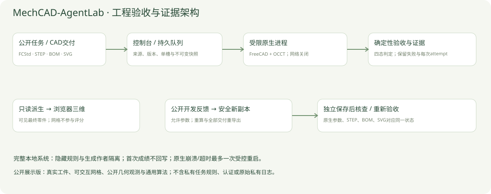
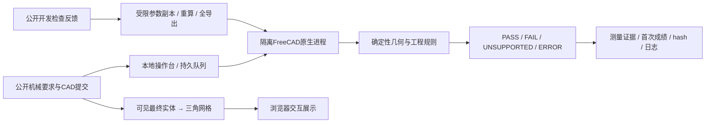
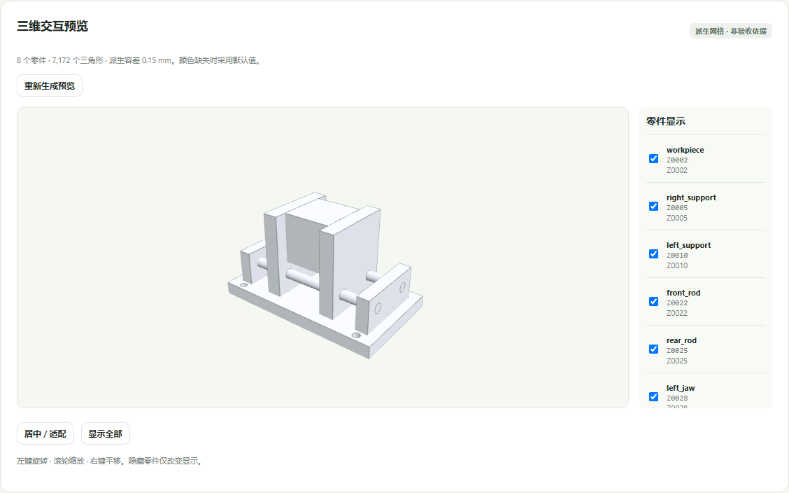
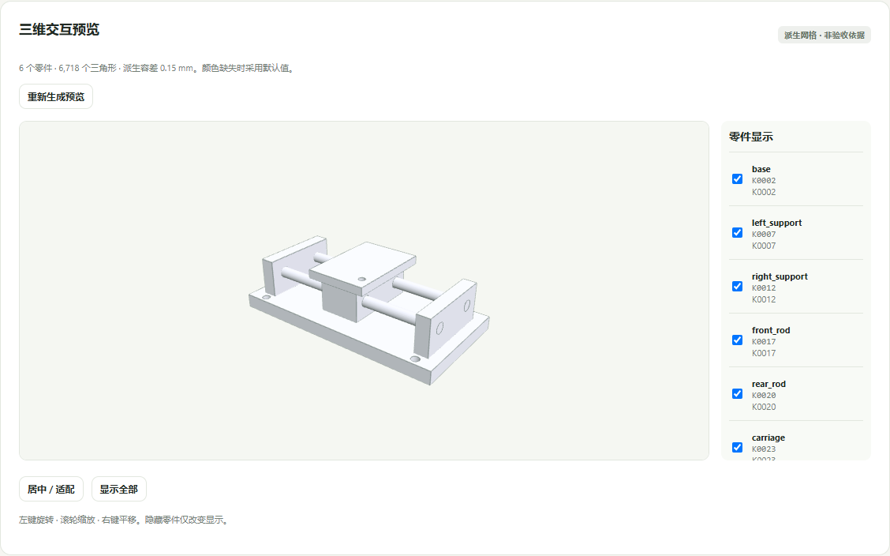
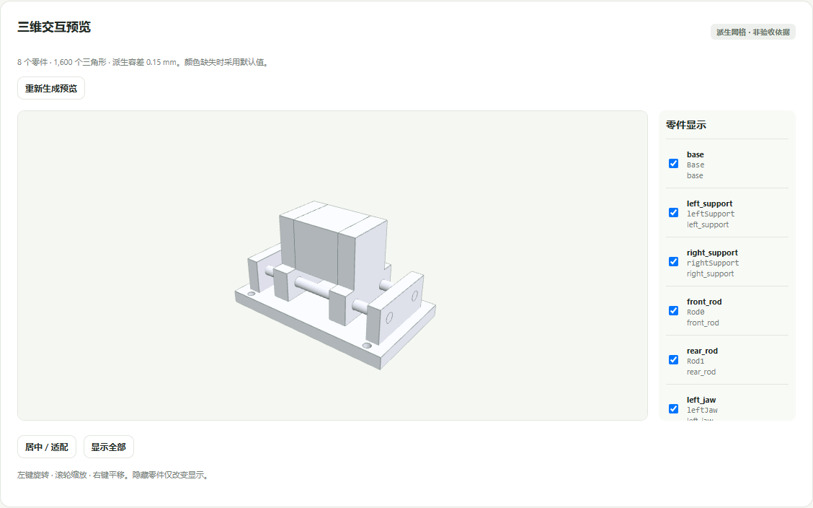
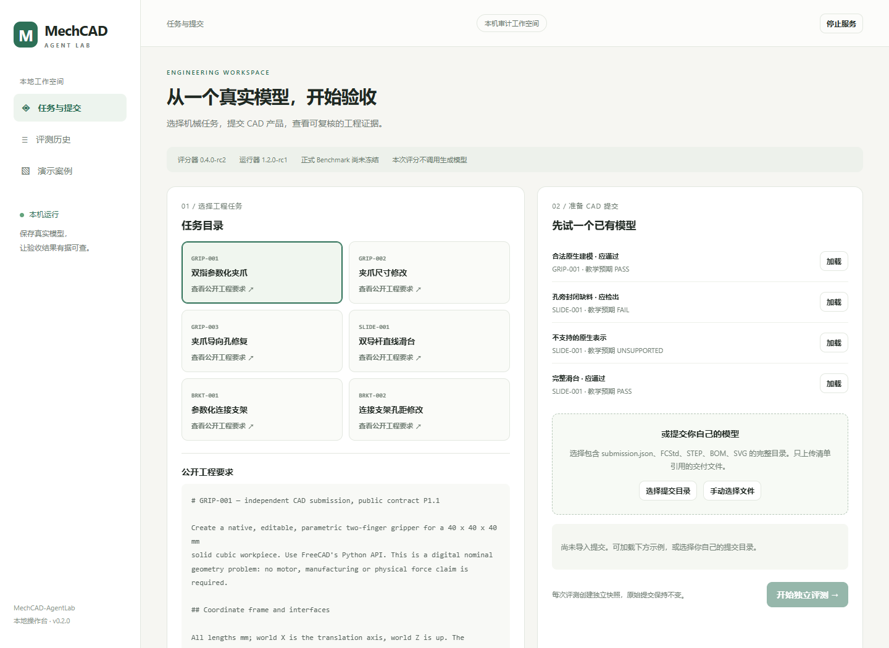
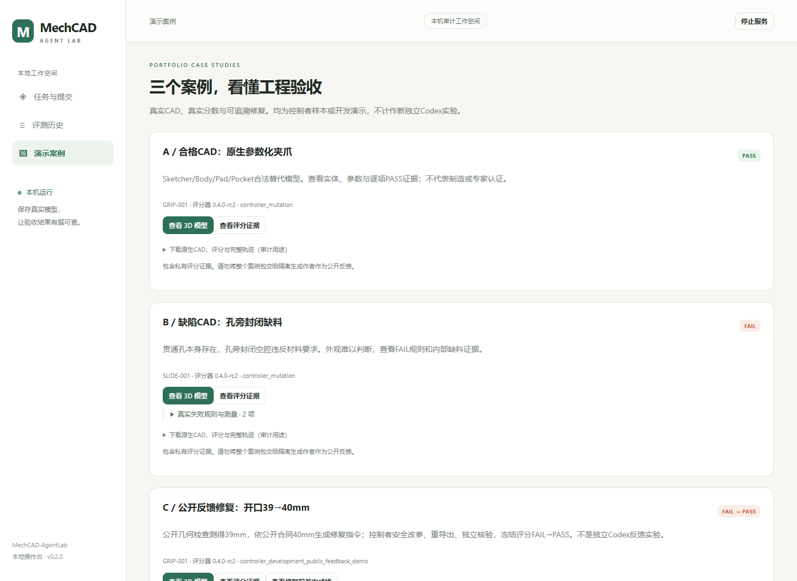

# MechCAD-AgentLab 正式项目展示报告

面向 Code Agent 数据工程师（CAD / 机械方向）｜2026-11-11

## 1. 解决的问题

Agent生成的CAD可能外观看起来正确，却包含封闭缺料、盲孔、断裂参数关联或不匹配的图纸。项目从保存的真实工程文件出发，把公开机械要求转化为确定性检查，并记录错误证据与修复轨迹。

目标是让工程师可以回答：交付是否满足合同、失败在哪里、证据是什么、修改后是否仍能重算，以及评分器对哪些表示尚不支持。

## 2. 架构与信任边界





评分、派生和生成来源分开记录。作者环境不得读取隐藏规则或参考实现，评分进程只读提交；三维网格不参与正式几何判定。私有评分报告不经公开反馈出口回传生成作者。

## 3. 评分器原理

|维度|方法|证据|
|---|---|---|
|原生与几何|类型/代理/外链预检；实体有效性、连接与材料区检查|原生类型、体积、包络、缺料或空域交叠|
|孔与接口|孔位、轴线、半径及全深空域，区分贯通与局部阻挡|轴偏差、半径、深度、残留材料|
|装配|实际接触、面积、正体积干涉、固定接口|距离、接触面积、交叠体积|
|参数化|原生驱动、修改重算、保存重开与离散姿态|驱动值、几何值、各姿态与固定件差异|
|交付|STEP与原生空间一致；BOM；从原生重生三视图进行关联|差体积、角色/数量/体积、投影关联|
|执行|独立进程、阶段日志、hash、最多一次原生故障恢复|所有attempt、退出码、超时与恢复记录|

工程判定与程序运行状态分开。完整FAIL不是服务崩溃；UNSUPPORTED不冒充模型工程失败；未取得可信完整报告时不默认PASS。全部关键规则通过才可在所选合同下判PASS。

LLM不直接判定客观几何指标。当前公差为项目名义数字样机约束，不能自动提升为制造标准。

## 4. 真实案例A：合格原生替代模型



GF01含原生Sketcher、Body、Pad、Pocket以及不同对象命名/驱动位置。它是开发控制样本，记录的冻结验收为PASS，不计作新独立Codex运行。

可下载完整原生交付，在FreeCAD修改参数，并检查表达式和特征树。在线模型是从该保存实体派生的7172个三角形，8个终端零件；不会重复显示建模中间特征。

## 5. 真实案例B：外观难以看出的材料缺失



GF07存在合法贯通孔，但孔旁还有封闭空腔，记录的冻结验收为FAIL。公开独立几何复核在carriage实体中观测到一个约 **0.00040212386 mm³** 的封闭内壳区域；原生输入hash核对未变，观测见[evidence/material_observations.json](../evidence/material_observations.json)。

该体积是保存BRep的实际数值，不是由构造器意图充当真值。此案例说明外表和孔中心线不足以证明完整功能材料区。是否构成工程违例依赖本项目合同，不能把任意空腔或这种数值阈值当成通用制造标准。

## 6. 真实案例C：公开反馈修复



```text
保存模型的开口为39mm
    ↓ 公开几何检查：默认要求40mm
生成公开反馈，并先固定修复请求
    ↓ 不使用隐藏失败信息作为修复提示
修改原生参数 → 强制重算 → 新FCStd / STEP / BOM / SVG / 清单
    ↓ 另进程保存后核查
冻结验收：原提交FAIL，新提交PASS
```

此项是实际执行的控制者开发修复演示。公开反馈只包含公开默认开口检查，不等同完整工程验收。源指令在读取本次隐藏成绩前固定。摘要见[evidence/public_repair_summary.json](../evidence/public_repair_summary.json)。

它证明工作流实际运行，不是独立Codex反馈对照实验，也不证明模型能力提升。

## 三维显示问题与修复

真实浏览器验收补查发现：无GUI元数据的源文件经离屏保存后，部分早期输出把全部终端实体记为隐藏。几何可以通过评分，但预览器遵守Visibility后无法显示。

修复包括：保存时明确继承/建立最终零件的可见性、隐藏中间特征；对历史文件创建独立可见审阅副本，原始修复模型和首次成绩不覆盖。案例C审阅副本的8个零件与原件几何差体积均为0，并另行评分PASS。

同时补上直接“查看3D”入口、自动加载、网格缓存、原件全隐藏时的可见副本操作，以及真实浏览器像素变化验证。这也是一个测试边界教训：API和场景数学通过不能替代实际浏览器显示。

## 7. 本地操作台的实际界面





本地操作台支持任务、提交、独立评分、嵌套证据、SVG/BOM、历史比较，以及允许参数的新副本重导出。在线公开页面只提供预先派生的真实模型和证据说明；不模拟在线参数重算或评分。

## 8. 验证数据及解释

- 评测准备阶段：114份已有/控制样本两轮，共228条评分；统计符合对应版本程序复核标签，不能替代专家真值。
- 作品阶段：20次评分请求保留10 PASS、5 FAIL、1 UNSUPPORTED与4次启动失败；16次实际评分原生进程、33次派生/一致性/异常核查进程尝试。上述是该阶段封存口径，不把后续显示修复混入原统计。
- 随后的显示问题修复：三个真实模型在Chrome/WebGL实际运行，验证旋转/缩放/平移/零件显隐/居中/刷新/缓存复用，未出现页面异常。截图来自该测试。
- 显示修复后的网页与协议回归证据单独保留；历史旧工件和冻结成绩不回写。

所有数字对应明确范围。控制器变体、评分重复、派生或显示修复均不作为新增独立作者episode。

## 9. 已知局限与Benchmark准备

1. 目前只有6道实际任务，24道仍为蓝图；正式Benchmark未冻结，72次实验未启动。
2. 60份匿名待审输入真实存在，但机械专家标签为0；公差适用性、合法替代和旧合同争议尚待审核。
3. 独立程序与评分器共享FreeCAD/OCCT，不能声称完全独立内核或第三方认证。
4. 离散运动采样不是全连续路径证明；没有力学、制造、摩擦或实物验证。
5. 任意NURBS、复杂Assembly/Link和任意工程图版式不在已验证的完整支持范围。
6. 本机运行验证不等于跨机器复现。另一位工程师仍需执行路径/环境适配及独立复现。

## 10. 工作归属

自建部分为合同、工程检查/证据、表示兼容、缺陷与反馈数据、执行隔离/恢复、参数交付与操作台。FreeCAD/OCCT和Three.js分别承担原生几何与显示。历史作者运行使用隔离Codex CLI，没有训练自研CAD大模型。

公开版不含宿主认证、本地会话、隐藏任务规则、参考生成源码或原始私有日志。可审计公开示例和通用算法；不声称能够重放未公开的正式Benchmark。
